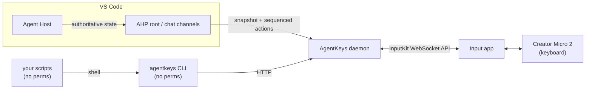

# AgentKeys

Turn a [Work Louder Creator Micro 2](https://worklouder.cc/creator-micro-2) or a
[Codex Micro](https://worklouder.cc/codex-micro) into an at-a-glance
control surface for up to 20 coding-agent sessions. AgentKeys connects VS Code, the command line,
and a local HTTP API to physical keys, so each concurrent session has a dedicated, color-coded
status indicator you can act on without hunting through editor tabs.

No custom firmware. AgentKeys uses the official `@worklouder/input-kit` client to
connect to Input.app's local WebSocket API for key events and status lighting.
**Keep Input.app running**: it owns the device connection and continues providing your macros.

| State   | Colour       | Meaning                        |
| ------- | ------------ | ------------------------------ |
| `idle`  | dim white    | free, or completed session acknowledged |
| `running` | blue, breathing | agent is thinking / executing |
| `done`  | green        | finished, output unread        |
| `input` | amber, breathing | paused, waiting on you     |
| `error` | red          | run failed                     |

## Demo

[](https://youtu.be/QpnkxvVaaSU)

## Why AgentKeys

- **Stay focused in VS Code.** AgentKeys automatically tracks VS Code Agent Host Protocol
  (AHP) sessions as they begin work, wait for input, finish, or fail. A physical
  key opens the exact project and conversation for its bound session, putting you back in context
  with one press.
- **See what needs attention first.** Breathing blue keys show active work, amber keys show
  sessions blocked on you, green keys show unread completion, and red keys surface failures.
  Parallel agents become easy to scan from your desk instead of easy to lose in a crowded editor.
- **Keep your current setup.** No custom firmware or keymap takeover is required. Input.app
  keeps providing your normal macros, while AgentKeys only updates the colors of the agent keys.
- **Fit it into any workflow.** Let VS Code assign and update slots automatically, or drive the
  same clear states from scripts, the CLI, or the localhost HTTP API.

| Feature | ChatGPT Codex | AgentKeys |
| --- | --- | --- |
| Works with stock firmware | yes | yes |
| Requires custom firmware | no | no |
| Open source | no | yes (MIT) |
| Supports Codex tasks | yes | no |
| Supports VS Code (Copilot / Agent Host) | no | yes |
| Key press opens session | yes (Codex task) | yes (VS Code chat) |
| CLI | no | yes |
| HTTP API | no | yes |
| Shell / script integration | no | yes |
| Agent key slots supported | 6 | 20 (`vscode00`–`vscode19`) |

## How it works



The daemon authenticates to `ws://127.0.0.1:19147/input`. Input asks you to approve
**AgentKeys** on the first connection; its credentials are then stored in macOS Keychain.
AgentKeys itself no longer needs Input Monitoring permission.

Lighting uses `setKeyLighting` with exact API Smart Action identifiers. Pending changes
are coalesced, acknowledged writes are cached, and rate-limited writes retry with backoff.
InputKit serializes requests and paces device writes. Input restarts and device reconnects
restore the current states; profile/layer changes trigger a repaint.

The daemon never reads or writes your keymap or installs layers. Configure the API Smart
Actions in Input once, wherever you want them.

## VS Code integration

VS Code is the automatic path: after installation, AgentKeys discovers local AHP
sessions, assigns a free slot when real work starts, and keeps that
key synchronized with the session's live state. Simply creating or browsing a session does not
claim a key, so the hardware reflects active work rather than editor clutter.

The installer asks how many keys you have activated (1–20) and saves that count.
Only those slots receive sessions and lighting updates. For example, choosing **6**
enables `vscode00` through `vscode05`; you do not need to map the remaining identifiers.
Use consecutive identifiers starting at `vscode00`. Input's API cannot read the active
layout's mappings, so this setting is user-configured rather than automatically detected.

After changing mappings in Input.app, run `agentkeys vscode reset`. It retries missing
API keys, frees every VS Code binding and publishes `idle` to the configured slots.
No daemon restart is needed for mapping changes within the configured count.
Unmapped identifiers are reported in the daemon log and
skipped until a profile/layer change, device reconnect, or explicit reset.

When a session needs an answer or approval, its key turns amber; active work breathes blue;
completed work turns green; and failures turn red. Pressing a bound agent key focuses the relevant
VS Code project window and opens that exact conversation. Opening a green key acknowledges the
completion by returning it to white, while keeping the shortcut bound so you can reopen the same
conversation. Opening a red key returns it to white and releases the failed binding so the slot can
be reused.

`scripts/install-agent.sh` installs the daemon, AHP-based VS Code integration, CLI and HTTP API. Use
`agentkeys vscode slots` to see current bindings, `agentkeys vscode open <slot>` to jump to one
from the terminal, `agentkeys-reset-vscode-slots` to free every binding, and
`agentkeys doctor vscode` to check the detected VS Code integration.

## Configure API Smart Action keys

The previous built-in agent bindings must be **replaced with API Smart Actions** in Input.
AgentKeys does not migrate or overwrite your layers automatically.

1. Open Input's **Smart Actions** panel and create a Smart Action.
2. Select the **API** tab and enter an identifier from `vscode00` through `vscode19`.
3. Save it and assign it to a key on your chosen layer.
4. Repeat for your chosen count, using consecutive identifiers from `vscode00`.
   Additional layers are optional; you only need to configure the number of keys you want.

| API identifier | AgentKeys slot |
| --- | --- |
| `vscode00` | 0 |
| `vscode01` | 1 |
| ... | ... |
| `vscode19` | 19 |

Identifiers are **case-sensitive and zero-padded**: `vscode0` and `VSCode00` are not valid
AgentKeys identifiers. The number identifies the slot, not the physical key position.
Other Smart Actions, ordinary keys, encoders and ambient lighting are left alone.
Press and click events open the bound session; release events are ignored.

See the [Work Louder WebSocket guide](https://docs.worklouder.cc/websocket/user-guide.md)
for Input's API Smart Action UI and supported devices (Creator Micro V2 Base/Pro and Codex Micro).

## Setup

Use **Node.js 22.4 or newer**, a current Input.app with the WebSocket API, and a supported device.

```sh
npm install
npm run build
scripts/make-app.sh        # builds AgentKeys.app
scripts/install-agent.sh   # runs it as a LaunchAgent, links the CLI
```

The installer prompts for your activated key count and stores it in
`~/.local/state/agentkeys/config.json`, for example:

```json
{ "keyCount": 6 }
```

Reinstalling prompts again, with your saved count as the default. At least one key is
required; the maximum remains 20 (`vscode00`–`vscode19`). No count is assumed on a fresh
installation. Missing or invalid configuration is reported instead of enabling every key.

To change the count later, rerun the installer, or run `node dist/configure.js` from
the repository and restart the daemon with `./scripts/restart-agent.sh` in your macOS
Terminal. The new count applies on startup. The HTTP API and CLI reject disabled slots;
`agentkeys status` and `agentkeys vscode slots` list only the configured slots.

Leave Input.app running when installing or restarting the daemon. On the first run,
approve **AgentKeys** in Input within **30 seconds**. Later connections authenticate
automatically using the `eu.okko.agentkeys.input` / `AgentKeys` Keychain item.
If access is revoked in Input, AgentKeys removes its saved credentials and requests approval
again. Failed approval attempts are spaced at least one minute apart.

`install-agent.sh` symlinks the `agentkeys` command into `~/.local/bin`, so that
directory has to be on your `PATH`; the script says so if it is not. The CLI is only an
HTTP client — it needs no permissions, and the checkout has to stay where it is because
the symlink and the LaunchAgent both point at it.

The VS Code integration tracks Agent Host Protocol (AHP) sessions.
`@microsoft/agent-host-protocol` provides discovery, snapshots, ordered state actions,
and reconnect replay.
Sessions must be exposed through AHP to be tracked.

Chat buttons open the exact host-advertised session resource in its project window
using `vscode://file/...?session=...`.
See [integration details](docs/vscode-integration-details.md) for the current contract
since VS Code 1.146.

The tiny `AgentKeys.app` packages the Node runtime for launchd. Re-run `make-app.sh`
after a Node upgrade. Input authorization is separate from the bundle's signature;
there is no AgentKeys Input Monitoring setup step.

`install-agent.sh` verifies that launchd is serving the newly built daemon and that the
daemon can connect to the keyboard. If keyboard access cannot be verified, installation
fails and explains the reported Input connection or authorization error.

## CLI Usage

```sh
agentkeys set 0 running "refactor auth"
agentkeys set 1 done
agentkeys set 2 input
agentkeys reset
agentkeys status
agentkeys log
agentkeys list-states     # list names and aliases
agentkeys vscode slots
agentkeys vscode reset
agentkeys vscode open 0
agentkeys doctor vscode
```

Aliases let scripts use their own vocabulary: `thinking`, `busy` and `working`
all mean `running`; `waiting`, `paused` and `blocked` mean `input`.

## HTTP API

Bound to `127.0.0.1` only, and requests must carry a loopback `Host` header so a web
page cannot drive your keyboard.

```
GET  /build                 -> { buildId }
GET  /state                 -> { connected, slots: [...] }
POST /slots/:index          <- { "state": "running", "label": "optional" }
POST /reset
GET  /integrations/vscode/slots
GET  /integrations/vscode/doctor
POST /integrations/vscode/slots/reset
POST /integrations/vscode/slots/:index/open
```

```sh
curl -s localhost:8787/build
curl -s localhost:8787/state
curl -s -X POST localhost:8787/slots/3 -H 'content-type: application/json' -d '{"state":"error"}'
```

## Wiring an agent to report its status in a key color

Give each session a slot number and call the CLI at the transitions you care about:

```sh
SLOT=0
agentkeys set $SLOT running "$(basename "$PWD")"
if my-agent-command; then agentkeys set $SLOT done; else agentkeys set $SLOT error; fi
```

## Environment variables

- `AGENTKEYS_PORT` overrides the port for both daemon and CLI.
- `AGENTKEYS_LOG` redirects daemon output to a file, needed when launched via
  LaunchServices, which discards stdout.
- `AGENTKEYS_VSCODE_USER_DATA` overrides the VS Code user-data directory used to discover
  authenticated local Agent Host protocol endpoints.
- `AGENTKEYS_VSCODE_STATE` overrides its persisted binding-state file.

## Logs

```sh
agentkeys log
```

## Known issues

- `~/.local/state/agentkeys/daemon.log` is not rotated automatically; log rotation is not yet
  implemented.

## Notes

- The daemon reconnects with backoff if Input exits; device-list events handle unplug/replug.
- Pressing `vscode00` through `vscode19` opens the corresponding bound VS Code session.
- With multiple supported devices, the first ready device is selected and retained while connected.

## Docs for development in this repository

- [How the VS Code integration works](docs/vscode-integration-details.md)
- [How to verify a monthly VS Code update](docs/vscode-update.md)
- [VS Code human-input evidence and coverage limits](docs/vscode-human-input-evidence.md)
- [How the daemon deployment is verified](docs/daemon-deployment.md)
- [docs/hardware-safety.md](docs/hardware-safety.md) — Input ownership and configuration safety.
- [docs/protocol.md](docs/protocol.md) — WebSocket events, authorization and lighting.
- [docs/development.md](docs/development.md) — launching and testing.
- [docs/findings.md](docs/findings.md) — integration constraints and hardware verification.

## Notice

This is an independent, unofficial personal project. It is not affiliated with,
sponsored by, endorsed by, or supported by Work Louder, OpenAI, or any other company
whose products it interoperates with. Product, company and interface names are used
only to identify the hardware and software involved, and remain the property of their
respective owners.

The repository contains original code only. Apart from the open-source npm packages it
declares as dependencies, it ships no third-party firmware, SDK or application code and
requires Input.app at runtime. The notes in `docs/` describe this integration; consult
Work Louder's documentation for the supported API contract.

Writing to a keyboard's on-device configuration can leave it unusable, and doing so may
affect any warranty or support you have from its manufacturer. This software is
provided as-is, without warranty of any kind. Use it at your own risk.
