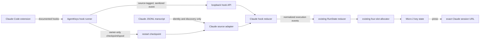

# Claude Code session status in VS Code

## Status

Planned, with production release blocked on the two evidence gates in
[Unresolved behavior gates](#unresolved-behavior-gates). No production code has been
changed for this integration.

This plan extends the existing VS Code integration to sessions owned by the
`anthropic.claude-code` extension. It preserves the current four-slot allocator, LED
states, and precedence:

```text
error > input > done > running > idle
```

The evidence behind this plan was collected from one active Claude Code session in VS
Code on 2026-08-10. Captured fixtures must record the exact VS Code, Claude Code
extension, and bundled Claude CLI versions before implementation claims are accepted.

## Goal

Show each active Claude Code VS Code session on the same four physical keys used by
native Copilot Chat and VS Code Agent Host sessions. A key must:

- turn blue while Claude is generating or running a tool;
- turn orange while Claude is blocked on a permission or question;
- turn green when the prompt completes normally;
- turn red on a terminal request failure;
- remain white when unbound or after a completed slot is acknowledged; and
- open the exact Claude Code session when pressed.

Claude sessions must compete for the existing four slots under the existing allocation
policy. Do not create a separate Claude-only slot pool and do not allow a Claude session
to replace a `running`, `input`, or `error` slot.

## Established integration facts

The investigation established these usable contracts:

1. The VS Code extension launches its bundled Claude executable in stream-JSON mode and
   resumes the same UUID-backed sessions used by Claude Code CLI.
2. Session transcripts are shared under `~/.claude/projects` as JSONL. Their structured
   records identify the session, workspace, messages, and tools, including that the
   session originated in VS Code.
3. Claude Code hooks execute for the extension and provide `session_id`,
   `transcript_path`, `cwd`, and `prompt_id`, plus event-specific tool identifiers.
4. The required lifecycle vocabulary is available through `SessionStart`,
   `UserPromptSubmit`, `PreToolUse`, `PermissionRequest`, `PostToolUse`,
   `PostToolUseFailure`, `Stop`, and `SessionEnd`.
5. Claude documents exact-session opening with:

   ```text
   vscode://anthropic.claude-code/open?session=<session-id>
   ```

The investigation also ruled out several tempting state sources:

- Transcript writes are asynchronous and do not provide an authoritative live `Stop`
  transition.
- Process presence is not execution state. The extension can retain both an empty panel
  process and a resumed-session process.
- The Claude processes do not retain an open transcript handle, so file-handle ownership
  cannot identify the active session.
- Transcript mtimes indicate writes, not whether execution is running, waiting, done, or
  failed.

Use Claude hooks as the authoritative live lifecycle. Use transcript contents only to
discover sessions, validate hook/checkpoint identity, and support bounded restart
recovery. Never infer live state from transcript mtime, process count, command line, or
open file handles.

## Target architecture



The source adapter owns Claude-specific discovery, payload validation, lifecycle
correlation, restart reconciliation, and opening. It emits the existing normalized
events from `src/vscode-chat-state.ts`:

```ts
{ type: 'request.started', requestId }
{ type: 'human-input.opened', requestId, blockerId, kind }
{ type: 'human-input.closed', requestId, blockerId, outcome }
{ type: 'request.finished', requestId, outcome }
```

Do not feed Claude JSONL into the Copilot compatibility gate or add Claude hook branches
to the legacy Copilot event reducer. Claude has a distinct producer contract and needs a
dedicated reducer that ends at the shared normalized event boundary.

## Data and identity model

### Session source

Add `SOURCE_CLAUDE_CODE = 'claude-code'` to `SessionSource`. Persist the source on every
Claude session and slot.

Use a compound internal key such as `<source>:<session-id>` for session maps and hook
routing. The public session ID remains Claude's UUID, but source tagging must prevent a
same-UUID native, Agent Host, and Claude session from overwriting or receiving each
other's events.

Claude candidates contain at least:

```ts
interface ClaudeCodeCandidate {
  source: 'claude-code';
  id: string;
  cwd: string;
  transcriptPath: string;
  resource: string;
}
```

Do not reuse Copilot's `eventsPath` semantics for a Claude transcript. Generalize the
internal session persistence shape or add a source-specific metadata object so code
cannot accidentally replay Claude JSONL with `reduceEvent`.

### Hook envelope

The hook runner must send an explicit producer tag because Claude and Copilot reuse
event names:

```ts
interface ClaudeCodeHookEnvelope {
  source: 'claude-code';
  hookEventName:
    | 'SessionStart'
    | 'UserPromptSubmit'
    | 'PreToolUse'
    | 'PermissionRequest'
    | 'PostToolUse'
    | 'PostToolUseFailure'
    | 'Stop'
    | 'SessionEnd';
  sessionId: string;
  transcriptPath: string;
  cwd: string;
  promptId?: string;
  toolUseId?: string;
  toolName?: string;
  timestamp: string;
}
```

The exact optional fields must follow captured payloads rather than assumptions. Reject
unknown sources, malformed UUIDs, non-absolute paths, unrecognized events, oversized
bodies, and event/path identity mismatches. Keep the loopback Host validation and body
limit in `src/daemon-http.ts`.

Never forward or persist prompt text, answers, tool input, command text, file contents,
model output, authentication material, or environment variables. Tool names and opaque
tool/prompt IDs are allowed only when needed for correlation. Diagnostics may include a
short session ID, event name, source, extension version, and a stable non-secret error
code.

### Durable checkpoint

Hooks can run while the daemon is restarting. The hook runner must therefore retain a
small owner-only checkpoint or append-only sanitized spool before attempting the
best-effort HTTP notification. The hook command must still finish quickly and must never
block Claude because AgentKeys is unavailable.

At minimum, a checkpoint records:

```ts
interface ClaudeCodeCheckpoint {
  source: 'claude-code';
  sessionId: string;
  transcriptPath: string;
  cwd: string;
  promptId: string | null;
  lastEvent: string;
  timestamp: string;
}
```

Retain the opaque blocker/tool ID and normalized outcome when needed to replay a wait or
failure. If a spool is used, consume it by byte offset and compact it only after the
daemon atomically persists the resulting checkpoint. Store files below the existing
AgentKeys state directory with mode `0600` in a mode `0700` directory. Bound file size,
handle partial final lines, and never derive state from file age.

Increment the VS Code integration state schema deliberately. Provide a migration from
the existing schema that leaves Copilot/native bindings unchanged and initializes no
Claude state. Do not make an existing install discard enabled bindings merely because
Claude support was added.

## Discovery and restart behavior

Implement Claude discovery beside `admit()` and `nativeCandidates()` in `src/vscode.ts`,
but keep parsing in a source-specific module.

1. Treat a valid `SessionStart` or `UserPromptSubmit` hook as immediate discovery input.
2. On daemon startup, enumerate owner-readable AgentKeys Claude checkpoints, then
   validate each against its transcript under the configured Claude projects root.
3. Optionally enumerate transcript JSONL files to find sessions that predate AgentKeys,
   but allocate no slot until a prompt lifecycle is observed.
4. Read structured records to confirm the UUID, absolute workspace path, and VS Code
   origin. Do not decode the project directory name as the workspace when the record has
   an explicit `cwd`.
5. Resolve the Claude root and transcript with `realpath`, require a regular readable
   file beneath that root, and reject traversal and symlink escapes.
6. Tolerate malformed and partial JSONL lines without treating them as state changes.

After restart, replay the sanitized hook checkpoint/spool into the Claude reducer. Use
the transcript to verify that the referenced session and prompt still exist, not to
invent a missing `Stop` or permission-resolution transition. Retain the last known state
on a transient read failure and surface a privacy-safe diagnostic.

If the checkpoint says `done`, keep the slot bound and green until acknowledged, matching
the existing behavior. `SessionEnd` releases live reducer resources and closes stale
blockers, but does not make an exact-session transcript impossible to reopen. A session
is unbound only under the existing missing-source policy or when its inactive slot is
reused.

## Claude lifecycle reducer

Create a small Claude-specific reducer/projection, preferably in
`src/claude-code-state.ts`. Its only output is normalized execution events.

Use the following target mapping, subject to captured payload parity:

| Claude hook | Normalized effect | Slot state |
|---|---|---|
| `SessionStart` | discover/validate session; no allocation by itself | unchanged |
| `UserPromptSubmit` | `request.started(prompt_id)` | `running` |
| `PreToolUse` | confirm active work; correlate tool ID | `running` unless an older blocker remains |
| `PermissionRequest` | open a stable permission/question blocker | `input` |
| `PostToolUse` | close the matching blocker/tool and continue request | `running` |
| `PostToolUseFailure` | close the matching blocker and apply the captured failure semantics | `running` or `error` as established by evidence |
| `Stop` | `request.finished(..., 'complete')` | `done` |
| terminal/API failure | `request.finished(..., 'failed')` | `error` |
| `SessionEnd` | clear live resources and reconcile terminal state | no stale `running`/`input` |

For a permission, use a blocker ID derived from source, prompt ID, and tool-use ID. For a
question tool, emit blocker kind `question`; otherwise emit `tool-confirmation`. Do not
use tool names as the only identity. Closing one blocker must not clear another blocker
for the same prompt.

Do not classify every `PostToolUseFailure` as a terminal request failure without a real
fixture proving that behavior. A recoverable tool error can be followed by more model
work. The reducer should close that tool's blocker and remain active unless the hook
payload or a separate captured terminal event establishes request failure.

Reject or fail closed on impossible event order, such as a permission event for a
different prompt than the active request, without changing another session. Duplicate
hooks must be idempotent. A new `UserPromptSubmit` clears terminal/error state and only
the blockers belonging to the previous prompt, as the existing normalized reducer does.

## Hook installation and transport

Reuse `dist/vscode-hook.js` and the loopback endpoint, but identify the producer at the
runner boundary. Install a distinct command such as
`agentkeys-claude-code-hook` that invokes the hook with `--source claude-code` or an
equivalent fixed environment value. Never infer the producer from overlapping event
names or transcript paths received over HTTP.

Add the eight Claude events to the user-level Claude Code hook configuration so CLI and
the VS Code extension both execute the same source-tagged runner. Installation must:

- parse and update Claude settings as structured JSON;
- preserve all user and third-party settings, matchers, and hooks;
- add each AgentKeys command at most once;
- be idempotent across repeated installs;
- write atomically with owner-only permissions; and
- remove only exact AgentKeys entries during uninstall.

Do not overwrite `~/.claude/settings.json`. Keep the existing Copilot hook file and
runner working unchanged.

`src/vscode-hook.ts` should sanitize Claude events in a separate branch from the current
Copilot question and terminal-confirmation logic. It should write the durable checkpoint
or spool, post the source-tagged envelope, and always emit the continuation response
expected by Claude Code even when storage or HTTP delivery fails.

Extend `src/daemon-http.ts` only enough to validate and pass the source-tagged envelope
to `VSCodeIntegration.applyHook`. Source-specific semantic validation belongs in the
adapter, not the HTTP router.

## Slot integration and exact opening

Update `src/vscode.ts` so Claude normalized events use the existing `RunState`,
`applyNormalizedEvents`, `allocate`, `onSlot`, persistence, acknowledgement, and reuse
logic. Keep the 20-slot firmware limit aligned with `INTEGRATION_SLOT_COUNT`, while enabling only
the sparse AG indices discovered in the device keymap.

Route hooks by the compound source/session key. A valid `UserPromptSubmit` allocates the
lowest free slot or the oldest reusable `done`/acknowledged `idle` slot. Session discovery
and `SessionStart` alone must not consume a slot.

Add a Claude URL builder in `src/vscode-app.ts` using `URL`/`URLSearchParams`:

```text
vscode://anthropic.claude-code/open?session=<validated-uuid>
```

`open()` selects the URL builder from `slot.source`. Preserve the current behavior where
opening a green slot acknowledges it to white without unbinding it. Verify that the
Claude extension is installed and that the exact deep link opens the requested session,
including when another VS Code window or Claude session is focused.

Extend `doctor()` with Claude-specific diagnostics: transcript root readability, hook
installation, checkpoint/spool readability, installed extension/version, discovered and
compatible session counts, and exact-open availability. A Claude failure must not make
healthy Copilot/native tracking unavailable, and vice versa.

## Unresolved behavior gates

The integration must remain experimental or disabled by default until both gates have
real, sanitized evidence. Do not cover either gap with elapsed-time assumptions,
transcript mtimes, process inspection, or optimistic state changes.

### Gate 1: user interruption

It is not established that pressing Claude Code's interrupt/stop control emits `Stop`.
Capture one prompt that is visibly generating, interrupt it, and record in total order:

- every hook name and its non-secret correlation IDs;
- the relevant structured transcript record;
- visible extension state immediately before and after interruption; and
- whether a later resume or prompt reuses the same session and prompt ID.

Pass condition: an immediate, session-correlated event can emit
`request.finished(..., 'cancelled')` or another agreed terminal outcome. If no such event
exists, the design needs a documented additional signal before shipping. Leaving the key
blue until another prompt or session end is not acceptable.

### Gate 2: permission approval before a long tool

It is not established what closes `input` immediately after the user approves a
permission when the approved tool runs for a long time. Capture a tool that requests
permission and then runs long enough to observe the post-approval interval. Record the
hook order around `PreToolUse`, `PermissionRequest`, approval, tool execution, and
`PostToolUse`.

Pass condition: an immediate, correlation-safe event closes the permission blocker while
the request remains active, producing `input -> running` before tool completion. If the
next event is only `PostToolUse`, a documented additional signal is required. A timeout
that guesses approval is not acceptable because it would turn denied or unanswered
permissions blue.

## Evidence and test plan

### Capture tooling and fixtures

Add a development-only Claude capture tool that records a whitelisted projection of hook
payloads and transcript structure. Raw captures remain outside the repository. Sanitize
home paths, UUIDs, timestamps, prompts, answers, commands, tool inputs/results, tokens,
and environment values before committing fixtures.

Capture at least:

1. session start and one normal prompt completion;
2. question opened, answered, and cancelled;
3. permission opened, approved, and denied;
4. permission approved before a long-running tool;
5. recoverable tool failure and terminal/API failure;
6. user interruption;
7. daemon restart while running, waiting, and done;
8. VS Code/extension restart followed by exact-session resume;
9. two concurrent Claude sessions in different workspaces; and
10. exact-session opening while a different Claude session is focused.

Store fixture provenance in a manifest with the VS Code version/commit, Claude Code
extension version, bundled CLI version, event name, scenario, capture date, sanitizer
version, and observed/unsupported status. Real records are required for observed claims.

### Unit tests

Add table-driven Claude reducer tests for:

```text
running -> input -> running -> done
running -> input -> done
running -> input -> error
running -> input -> cancelled/done
```

Also cover duplicate/out-of-order events, stale prompt IDs, two blockers closed in both
orders, a recoverable tool failure, a terminal failure, a new prompt after done/error,
and `SessionEnd` from every nonterminal state.

### Discovery, transport, and privacy tests

Test:

- transcript and checkpoint discovery without mtime-based status inference;
- partial/malformed JSONL, truncation, replacement, symlink escape, and path traversal;
- hook source tagging and same UUIDs in two different sources;
- rejection of unknown events and mismatched transcript/session IDs;
- no prompt, command, answer, tool input/result, token, or environment leakage;
- durable delivery across daemon downtime and idempotent replay after restart;
- body-size and owner-permission enforcement; and
- idempotent settings merge/removal without changing unrelated Claude hooks.

### Integration tests

Extend `test/vscode.test.mjs`, `test/vscode-hook.test.mjs`, and the HTTP tests to prove:

- Claude prompts share the existing four-slot allocator with both Copilot sources;
- no active slot is stolen;
- `onSlot` fires once per effective state change;
- restart restores `running`, `input`, `done`, and `error` from validated checkpoints;
- missing/unreadable Claude state affects only the corresponding Claude slot;
- opening uses the exact Anthropic URL and acknowledges `done` without unbinding; and
- the same UUID in Claude and native Chat remains two independent sessions.

Run the focused tests after each implementation slice, then finish with:

```sh
npm run check
npm test
```

## Implementation sequence

### Phase 0: resolve evidence gates

1. Add only the development capture runner and sanitizer.
2. Record the installed component versions and a baseline normal lifecycle.
3. Capture interruption and long-tool permission approval.
4. Update this plan with the observed event contracts or mark the feature blocked.

Do not edit the production reducer before the experiments identify both required exit
transitions.

### Phase 1: source and opening contracts

1. Add `claude-code` to `SessionSource` and introduce compound internal session keys.
2. Add the exact Claude URL builder and focused tests.
3. Extend persisted source metadata with a migration that preserves existing bindings.

### Phase 2: safe hook transport

1. Add the fixed-source Claude hook runner and strict sanitizer.
2. Add owner-only durable checkpoints/spooling and best-effort loopback notification.
3. Extend the HTTP envelope with explicit source identity.
4. Add structured, idempotent Claude settings installation and removal.

### Phase 3: discovery and reducer

1. Implement transcript/checkpoint validation and Claude candidate discovery.
2. Implement the dedicated Claude lifecycle reducer against captured fixtures.
3. Reconcile checkpoints on restart without deriving state from timing or processes.

### Phase 4: shared slot integration

1. Route Claude normalized events through the existing `RunState` and allocator.
2. Persist bindings and source-specific metadata.
3. Add source-specific exact opening, acknowledgement, diagnostics, and failure isolation.

### Phase 5: production evidence and documentation

1. Run the complete fixture, privacy, reducer, restart, allocator, and opening matrix.
2. Verify both unresolved gates against the production path, not only the capture tool.
3. Update `docs/vscode-integration-details.md`, installer/removal documentation, and
   `README.md` with supported versions and setup.
4. Mark this plan complete only after the full `npm test` suite passes and both evidence
   gates have committed, provenance-checked fixtures.

## Expected file changes

- `src/vscode-chat-state.ts`: add the source constant/type and retain the normalized
  reducer boundary.
- `src/claude-code-state.ts`: validate Claude hooks and reduce them to normalized events.
- `src/claude-code-session-files.ts`: discover and validate transcripts/checkpoints.
- `src/vscode-hook.ts`: source-tag, sanitize, checkpoint, and forward Claude hooks.
- `src/daemon-http.ts`: accept the source-tagged hook envelope.
- `src/vscode.ts`: discover Claude candidates, route hooks, persist state, and share slots.
- `src/vscode-app.ts`: build and launch the exact Anthropic session URL.
- `scripts/install-agent.sh` and `scripts/remove-agent.sh`: merge/remove AgentKeys Claude
  hooks without disturbing user configuration.
- `scripts/dev/`: add the capture/sanitization workflow and fixture manifest validation.
- `test/`: add reducer, hook, discovery, persistence, allocator, HTTP, and opening tests.
- `docs/vscode-integration-details.md` and `README.md`: document supported behavior and
  remaining version constraints after the gates pass.

File boundaries may be adjusted to match implementation pressure, but Claude transcript
parsing and hook semantics must remain source-specific rather than expanding the Copilot
event parser.

## Acceptance criteria

Claude Code support is production-ready only when all of the following are true:

- both unresolved behavior gates have real sanitized fixtures and deterministic reducer
  transitions;
- hooks are installed without overwriting or duplicating existing Claude configuration;
- no sensitive prompt, answer, command, tool payload, path, token, or environment value
  reaches AgentKeys logs or committed fixtures;
- live and restarted sessions produce correct `running`, `input`, `done`, and `error`
  states without timers or process/mtime heuristics;
- Claude, native Chat, and Agent Host sessions safely share four slots;
- a physical key opens the exact Claude UUID and acknowledges `done` consistently;
- source loss or malformed Claude data cannot corrupt a Copilot session or another Claude
  session;
- `doctor()` explains missing hooks, extension, transcript access, or opening support;
  and
- `npm run check` and `npm test` pass in full.